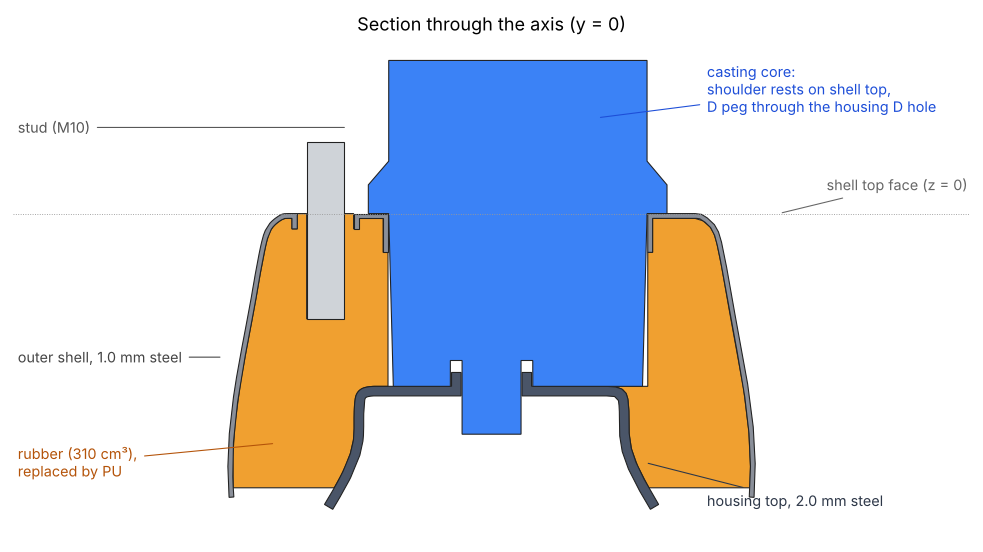
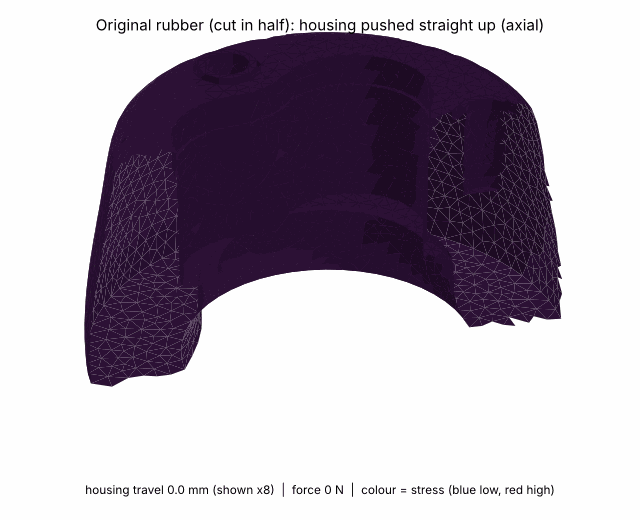

# Datsun 280Z strut isolator: FreeCAD model, FEM and casting core

**What this is.** The rubber in a Datsun 280Z (S30) strut top isolator has failed. This repo holds a parametric FreeCAD model of
the part, a stiffness check of the original rubber, and a printable casting core for refilling it with polyurethane.
The model was reverse-engineered from two 3D scans. The blue part in the section above is the removable core that keeps the service
opening free while the PU cures; the rest is steel (grey) and the original rubber volume (orange).

**Is it finished?** The geometry and the core are done; the PU repair itself is not yet tested. The fit of the core against the real
parts and the D-flat angle are the main things still to verify (see "Unknowns" below).

Reverse-engineered from two Revopoint scans (`1009_01_mesh.ply` outer pressed shell, `1009_02_mesh.ply` housing top) of a failed
rubber strut isolator. Goal: repair by casting polyurethane into the cavity, with a removable core that keeps the
trilobal service opening free (it gives access to the nut on the strut shaft through the D-shaped hole).

The raw scans are in `scans/` as lossless xz archives (19 MB and 40 MB; the uncompressed PLY files are 49 MB and 101 MB and are git-ignored,
because GitHub rejects files over 100 MB). Unpack with `xz -dk scans/1009_01_mesh.ply.xz scans/1009_02_mesh.ply.xz`.

## Layout
| Path | What |
|---|---|
| `freecad/StrutIsolator.FCStd` | the model (open in FreeCAD 1.1) |
| `freecad/strut_isolator_v6.FCMacro` | **current** macro, rebuilds everything from parameters. Set `EXPORT_DIR` to also write STEP/STL |
| `freecad/archive/` | earlier macro versions (surface-only models, offset-thickness attempts) |
| `step/` | outer shell (1.0 mm), housing top (2.0 mm), original rubber volume, casting core |
| `print/` | casting core STL; `casting_core_print_orientation.stl` is turned foot-down for FDM |
| `fem/` | CalculiX results as surface data (`fem_surface.json`), animations, `make_gifs.py` |
| `images/` | cross-section through the axis |
| `scans/` | Revopoint PLY scans, xz-compressed (lossless) |
| `analysis/` | scan-fitting helper scripts (PLY loader, spline and trilobal fits) |

## Model
Shared axis = Z, outer shell top face at z = 0.
- Outer shell: spline-revolved pressed cup, trilobal opening with stamped 8.1 mm lip, 3 x 13.3 mm bolt holes on r = 34.85 with 3.2 mm collars.
- Housing top: spline-revolved inner cup, D-shaped shaft hole (R 6.36, flat 4.85) with 4.9 mm collar, rim 2.5 mm below the shell rim.
- Studs: 3 x 10 mm cylinders (M10x1.25), 22 mm embedded, 15 mm exposed. **Assumptions.**
- Rubber: about 310 cm3 between the sheets, trilobal void hollow down to the housing face, bottom recessed 2 mm (**assumption**).
- Casting core: draft body down to the housing plate, 6 mm shoulder resting on the shell top face (height index), 50 degree cone under the shoulder
  (prints without supports foot-down), 26 mm foot (clears the studs when inverted), D peg through the housing D hole plus a pocket around the D
  collar (registers the housing).

### Unknowns to measure on the real parts
- Rotation of the D flat relative to the bolt pattern (`D_ANGLE`, currently arbitrary).
- Sheet thicknesses (1.0 / 2.0 mm assumed), stud embed, rubber bottom recess depth.

## FEM (CalculiX via FreeCAD, rubber only, bonded)
### FEM animations
Original rubber, cut in half, 1 mm of housing travel (shown 8x, colour = stress). Red marks the spots that work hardest: around the
studs and at the housing interface.

| Axial (up/down) | Radial (sideways) |
|---|---|
|  |  |

Linear elastic, E = 4.2 MPa, nu = 0.49 (about 60 Shore A), 1 mm housing displacement, shell and studs fixed:
- axial 592 N/mm, radial 840 N/mm (housing nodes free to slide in plane; a rigid-body housing is stiffer: about 760 N/mm axial).
- Nonlinear Neo-Hookean (G = 1.4 MPa, K = 70 MPa), 3 kN axial: 3.7 mm squash (750 N: 1.0 mm, 1.5 kN: 1.9 mm, 2.25 kN: 2.8 mm).
- Cornering case (3 kN + 2 kN lateral) did not converge past about 65 % of the load; not conclusive.
- Plugging the void with same-hardness PU raises axial stiffness about 21 %; the void must stay open for access, so use the core.
These are stiffness comparisons, not durability predictions. Real load path (spring seat, tilting moment) is not modelled.

## Material notes
VytaFlex 60 (Smooth-On, KauPo 60/1, 0.91 kg kit): Shore 60A, 480 % elongation, 60 min pot life, 16 h cure, 1A:1B by volume.
About 310 ml needed, order for about 380 ml mixed. Prime the steel. KX Flex 60 was rejected (125 % elongation, 2.5 min pot life).
